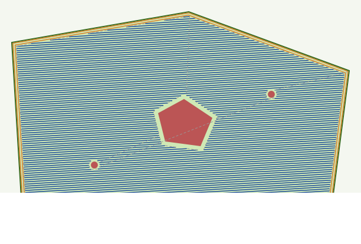

# 08 – Mähplanung & Missionen

## 1. Felddefinition (GeoJSON)

Felder, Sperrflächen und Wege werden als **GeoJSON** (WGS84, Längengrad/Breitengrad)
gespeichert – lesbar in QGIS, geojson.io, Google Earth (Konvertierung) und per Skript.

```json
{
  "type": "FeatureCollection",
  "properties": {"name": "Beispielwiese", "datum": [47.26010, 11.39210, 600.0]},
  "features": [
    {"type": "Feature", "properties": {"role": "field", "name": "Wiese Nord"},
     "geometry": {"type": "Polygon", "coordinates": [[[11.3921, 47.2601], ...]]}},
    {"type": "Feature", "properties": {"role": "keepout", "name": "Obstbaum 1", "buffer_m": 1.0},
     "geometry": {"type": "Point", "coordinates": [11.3925, 47.2605]}},
    {"type": "Feature", "properties": {"role": "keepout", "name": "Teich"},
     "geometry": {"type": "Polygon", "coordinates": [[...]]}},
    {"type": "Feature", "properties": {"role": "entry", "name": "Einfahrt"},
     "geometry": {"type": "Point", "coordinates": [11.3920, 47.2600]}},
    {"type": "Feature", "properties": {"role": "route", "name": "Feldweg"},
     "geometry": {"type": "LineString", "coordinates": [[...], [...]]}}
  ]
}
```

| `role` | Geometrie | Bedeutung |
|---|---|---|
| `field` | Polygon | Zu mähende Fläche (Außengrenze, Löcher erlaubt) |
| `keepout` | Polygon / Point (+ `buffer_m`) | Sperrfläche: Bäume, Masten, Teich, Beete |
| `entry` | Point | Ein‑/Ausfahrt des Feldes, Start der Mähbahnen |
| `route` | LineString | Befahrbarer Verbindungsweg (Routengraph) |
| `depot` | Point | Abstell‑/Ladeplatz |
| `geofence` | Polygon | Äußerste erlaubte Grenze (Safety‑Supervisor, hart) |

Beispiel: [`missions/beispiel_wiese.geojson`](../ros2_ws/src/tank01_bringup/missions/beispiel_wiese.geojson).

**Erfassen von Grenzen:** (a) in QGIS über Orthofoto (Genauigkeit ~0,5 m – mit 1 m
Sicherheitsabstand planen), (b) Abfahren der Grenze mit Tank01 in Fernsteuerung und
Aufzeichnung der RTK‑Positionen (`ros2 run tank01_mower record_boundary`), Genauigkeit ~3 cm.

## 2. Bahnplanungs‑Algorithmus

Implementiert in [`tank01_mower/coverage.py`](../ros2_ws/src/tank01_mower/tank01_mower/coverage.py).

```
  ┌──────────────────────────────────────────┐
  │ ╔══════════════════════════════════════╗ │  ← Vorgewende‑Runden (Headland),
  │ ║ ───────────────────────────────────▶ ║ │    zuletzt gemäht (entfernt Wendespuren)
  │ ║ ◀─────────────────────────────────── ║ │
  │ ║ ──────────▶  ▓▓▓▓ ─────────────────▶ ║ │  ← Streifen (Swaths), um Sperrfläche ▓
  │ ║ ◀──────────  ▓▓▓▓ ◀───────────────── ║ │    unterbrochen
  │ ║ ───────────────────────────────────▶ ║ │
  │ ╚══════════════════════════════════════╝ │
  └──────────────────────────────────────────┘
```

1. **Projektion:** WGS84 → lokales ENU (exakt über ECEF, Bezug: Datum des Feldes).
2. **Vorgewende:** Feldgrenze um `(i + 0,5) · b_eff` nach innen versetzen (i = 0…n‑1)
   → n Umfahrungsrunden. Innere Fläche = Grenze um `n · b_eff` versetzt.
3. **Sperrflächen:** um `buffer + b/2` vergrößert, als Löcher behandelt.
4. **Fahrtrichtung:** automatisch entlang der längsten Polygonkante (minimiert Wendungen)
   oder vorgegeben (`swath_angle_deg`, z. B. parallel zu PV‑Reihen oder hangparallel).
   **Am Hang immer schichtlinienparallel planen, wenn die Querneigung ≤ 15° bleibt**,
   sonst in Falllinie (bergauf/bergab).
5. **Streifen:** Parallele Linien im Abstand `b_eff = b · (1 − Überlappung)` werden mit
   Innenfläche und Löchern geschnitten → Intervalle = Streifen.
6. **Reihenfolge:** Boustrophedon (Hin‑ und Rückfahrt im Wechsel); bei mehreren
   Intervallen pro Linie (konkave Felder, Löcher) greedy nach kürzestem Verbindungsweg.
7. **Übergänge:** Benachbarte Streifen → Wende im Vorgewende (Mähwerk bleibt an).
   Größere Sprünge → Mähwerk aus, Transitfahrt.
8. **Abtastung:** Wegpunkte alle 2 m mit Orientierung (`yaw`) → Nav2 Posen.

Ergebnis für das Beispielfeld (≈ 1,1 ha, Teich + 2 Obstbäume; blau = Streifen,
orange = Vorgewende, gestrichelt = Übergänge mit Mähwerk aus):



Wendemanöver: Ist der Streifenabstand kleiner als 2 × Mindestwenderadius, wird eine
**„Birnenwende“ (Ω‑Turn)** gefahren oder nur jeder zweite Streifen hintereinander
gemäht (Streifen‑Überspringen, `skip: 1`), was die Grasnarbe schont.

Für komplexe Felder ist die Bibliothek **Fields2Cover** (BSD‑3) eine leistungsfähige
Alternative (Zerlegung, Dubins‑Wenden, Routenoptimierung); das Interface
(`plan_coverage(field, params) → [Segment]`) ist so gewählt, dass sie später als
Backend eingesetzt werden kann.

### 2.1 Parameter (`config/mower.yaml`)

| Parameter | Standard | Bedeutung |
|---|---|---|
| `cut_width` | 1.0 | Arbeitsbreite b [m] |
| `overlap` | 0.10 | Überlappung (Anteil) |
| `headland_passes` | 2 | Anzahl Vorgewende‑Runden |
| `swath_angle_deg` | `auto` | Fahrtrichtung der Streifen |
| `min_swath_length` | 2.0 | Kürzere Reststücke verwerfen [m] |
| `waypoint_spacing` | 2.0 | Abstand der Wegpunkte [m] |
| `mow_speed` | 1.0 | Mähgeschwindigkeit [m/s] |
| `blade_rpm` | 2400 | Solldrehzahl Mähwelle |
| `cut_height` | 0.07 | Schnitthöhe [m] |
| `load_slowdown_current` | 60.0 | Mähwerkstrom [A], ab dem die Geschwindigkeit reduziert wird |

## 3. Missions‑Zustandsautomat

```
         ┌───────┐ start  ┌──────────┐  Plan ok  ┌──────────┐ am Feld ┌──────────┐
         │ IDLE  │───────▶│ PLANNING │──────────▶│ TRANSIT  │────────▶│  MOWING  │
         └───────┘        └──────────┘           └──────────┘         └────┬─────┘
             ▲                  │ Fehler               │                    │ alle Streifen
             │                  ▼                      │                    ▼
             │             ┌─────────┐                 │               ┌───────────┐
             │             │  FAULT  │◀─── Nav‑Fehler ─┤               │ RETURNING │
             │             └─────────┘                 │               └─────┬─────┘
             │                  ▲                      ▼                     │
             │                  │              ┌──────────────┐              │
             │                  └──────────────│   PAUSED     │◀── Safety ───┤
             │                    Timeout      │ (Mähwerk aus)│   PAUSE/STOP │
             │                                 └──────┬───────┘              │
             │                                        │ frei → fortsetzen    │
             └──────────────── DONE ◀─────────────────┴──────────────────────┘
```

- **Fortschritt** (Index des aktuellen Streifens/Wegpunkts) wird nach jedem Streifen in
  `~/.tank01/mission_state.json` gespeichert → Fortsetzen nach Unterbrechung/Neustart.
- **Akku:** Unterschreitet der SoC die Reserve für den Rückweg (Routenlänge × Verbrauch/m
  × 1,3 + 10 %), wird `RETURNING` ausgelöst.
- **Bericht:** Fläche, Dauer, Energie, Ereignisse als JSON in `/mission/state` und als
  Datei.

## 4. Mission starten

```bash
ros2 launch tank01_mower mission.launch.py \
     field:=/pfad/zu/feld.geojson start:=true

# Status
ros2 topic echo /mission/state
# Pause / Fortsetzen / Abbrechen
ros2 service call /mission/pause  std_srvs/srv/Trigger
ros2 service call /mission/resume std_srvs/srv/Trigger
ros2 service call /mission/abort  std_srvs/srv/Trigger
```

Offline‑Vorschau einer Planung (ohne ROS):

```bash
python3 -m tank01_mower.coverage ros2_ws/src/tank01_bringup/missions/beispiel_wiese.geojson
```
